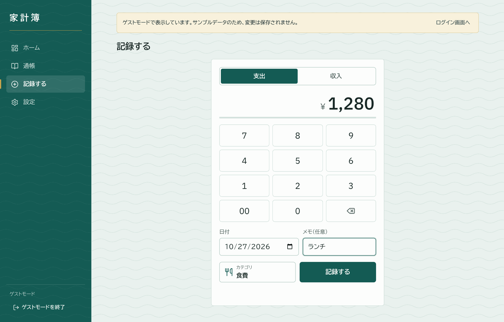

# 家計簿SPA

収入と支出を記録して、毎月の残高を確かめられる家計簿アプリです。
**銀行の通帳**をモチーフにデザインしていて、取引は通帳の記帳行のように「日付・摘要・支出・収入・残高」で並びます。
Googleアカウントでログインしてクラウドに保存でき、ログインせずに **「ゲストで試す」** からサンプルデータで全機能を試すこともできます。

**デモ：** [kakeibo-spa.vercel.app](https://kakeibo-spa.vercel.app)（ログイン画面の「ゲストで試す」からすぐ触れます）

<p>
  
  
</p>

> スクリーンショットはゲストモード（サンプルデータ）で撮影しています。

---

## デザインのコンセプト

「お金の記録」と聞いて多くの人が思い浮かべる **通帳** を土台にしました。

- **通帳ページ**：取引を古い順に並べ、行ごとに月初からの残高を表示します。数字は等幅の数字（tabular-nums）で桁をそろえています
- **表紙**：サイドバーとログイン画面は、深い青緑に金の線を入れた通帳の表紙のデザインです
- **地紋**：背景には通帳の地紋のような細い波線を薄く敷いています
- **グラフは1色**：カテゴリ別の支出は円グラフをやめ、1色の横棒グラフにしました。色で区別するより、長さで比べるほうが読み取りやすいためです

| 色 | 用途 |
|---|---|
| `#145B54` 青緑 | 表紙・主要なボタン |
| `#E9F1EE` 淡いミント | 背景（通帳の地） |
| `#CFDFD9` | 罫線 |
| `#C8A44D` 金 | 表紙の線（装飾はここだけ） |
| `#008A74` | グラフ |

文字は、読みやすさを重視したユニバーサルデザインフォントの **BIZ UDPゴシック**、数字は **IBM Plex Sans** の等幅数字を使っています（どちらもアプリに同梱）。

---

## 画面

### ログイン
通帳の表紙をイメージした画面です。Googleでログインするか、ゲストモードで試せます。

| PC | スマホ |
|---|---|
|  |  |

### ホーム
今月の残高を大きく表示し、支出の累計の推移とカテゴリ別の支出、最近の記録をまとめています。

| PC | スマホ |
|---|---|
|  |  |

### 通帳
月ごとの取引を通帳の記帳行で表示します。行をクリック（スマホではタップ）すると、その場で編集・削除できます。

| PC | スマホ |
|---|---|
|  |  |

### 記録する
テンキーで金額を入力し、カテゴリはボトムシートから選びます。最近使ったカテゴリが上に出ます。

| PC | 金額入力（スマホ） | カテゴリ選択（スマホ） |
|---|---|---|
|  |  |  |

---

## 使用技術

| カテゴリ | 技術 |
|---|---|
| フロントエンド | React 19, React Router v7, Vite 7 |
| スタイル | プレーンCSS（CSS変数・メディアクエリ） |
| グラフ | Recharts |
| アイコン | lucide-react |
| フォント | BIZ UDPゴシック、IBM Plex Sans（@fontsource で同梱） |
| 認証 | Firebase Authentication（Googleログイン） |
| DB | Cloud Firestore（セキュリティルールでユーザーごとにアクセス制御） |
| デプロイ | Vercel |

---

## 主な機能

### ① 記録する（電卓UI）
- テンキー入力で金額を入力（`00` キー・1文字削除あり）
- 支出 / 収入の切り替え、日付・メモの入力
- カテゴリ選択はボトムシート形式。最近使ったカテゴリを上部に表示（localStorageに保存）
- 記録すると内容を確認するメッセージを表示

### ② ホーム
- 今月の残高（収入 − 支出）と収入・支出の合計
- 支出の累計の推移グラフ（ホバーでその日までの累計を表示）
- カテゴリ別の支出（上位5件＋その他）
- 最近の記録5件
- 定期取引を今月分としてまとめて記録するボタン

### ③ 通帳
- ◀▶で月を切り替え
- 日付・摘要・支出・収入・残高（月初から）の記帳行と、月の合計
- 行をクリックしてその場で編集（カテゴリは一覧から選択 or 新規入力）・削除（確認あり）

### ④ カテゴリ管理
- カテゴリの追加・削除（カテゴリ名からアイコンを自動で割り当て）
- 初回ログイン時にデフォルトカテゴリ（食費・日用品・交通 など10件）を自動登録

### ⑤ 定期取引
- 家賃・通信費などの固定費／給与をテンプレートとして登録
- ホームのボタンで当月1日付の取引としてまとめて記録
- 同じ月に何度押しても二重登録されない

### ⑥ ゲストモード
- ログインなしで、サンプルデータを使って全機能を操作できる
- データはメモリ上だけに置き、保存はしない（リロードでサンプルに戻る）

---

## 設計のポイント

### 機能単位のディレクトリ構成
```
src/
├── app/            # ルーティング・共通レイアウト・ルートガード
├── data/           # データの保存先（Firestore / ゲスト用）
├── features/
│   ├── auth/         # 認証（AuthContext, LoginPage）
│   ├── dashboard/    # ダッシュボード
│   ├── transactions/ # 取引の追加・一覧・TransactionsContext
│   └── settings/     # カテゴリ・定期取引（useCategories, useRecurring）
├── shared/         # 汎用Hook（useLocalStorage）・表示用の関数・カテゴリアイコン
└── lib/            # Firebase初期化・日付ユーティリティ
```

### 保存先を差し替えられるリポジトリ層
データの読み書きを `data/firestoreRepo.js`（Firestore）と `data/guestRepo.js`（メモリ上のサンプルデータ）に分け、どちらも同じAPI（`listTransactions` / `addTransactions` など）を持たせています。
`AuthContext` がログイン方法に応じてどちらかを渡すので、画面側は保存先の違いを意識せずに同じコードで動きます。ゲストモードはこの仕組みで実現しています。

```js
// ログイン方法に応じて保存先を切り替える（AuthContext）
const repo = useMemo(() => {
  if (guestRepo) return guestRepo;                    // ゲスト → サンプルデータ
  if (user) return createFirestoreRepo(user.uid);     // Googleログイン → Firestore
  return null;
}, [guestRepo, user]);
```

### Context / カスタムHookによる関心の分離
取引は `TransactionsContext`、設定系は `useCategories` / `useRecurring` に処理をまとめ、UIコンポーネントはデータ操作の詳細を知らなくて済む設計にしています。
取引データはダッシュボード・一覧・追加の3画面で共有するため Context にまとめ、追加した取引がすぐ他の画面にも反映されるようにしています。

### Firestore セキュリティルールでユーザーごとにデータを分離
データは `users/{uid}/transactions` のようにユーザーごとのパスに保存し、セキュリティルールで「ログイン中の本人のパスだけ読み書きできる」ようにしています。フロントエンドから直接DBを操作する構成でも、他ユーザーのデータにはアクセスできません。取引は種別・金額・日付の形もルール側でチェックしています（`firestore.rules`）。

```
match /users/{uid}/transactions/{id} {
  allow read, delete: if isOwner(uid);
  allow create, update: if isOwner(uid) && isValidTransaction(request.resource.data);
}
```

### 定期取引の二重反映を「IDの設計」で防ぐ
定期取引から反映した取引のIDを `rec_{テンプレID}_{月}` に固定しています。同じ月に何度反映しても同じIDへの書き込みになるため、データが重複しません。

### 日付はローカル時刻で扱う
`toISOString()` はUTCになり、日本時間の0〜9時に「前日」扱いになるため、日付の計算は `lib/dates.js` にまとめてローカル時刻で行っています。

### React Context による認証状態の一元管理
`AuthContext` でログイン状態をグローバルに管理し、`RequireAuth` コンポーネントで未ログイン時はログイン画面を表示するルートガードを実装しています。

### スマホファーストUI
- PC：左に通帳の表紙のようなサイドバー、通帳ページは5列（支出・収入・残高を別の列）
- スマホ（768px以下）：画面下部のタブ。通帳ページは「日付・摘要・金額（＋/−付き）」の3列にまとめ、行をタップして編集

色・余白・角丸はCSS変数にまとめ、メディアクエリで両対応しています。

### アクセシビリティ
- 通帳ページは `role="table"` などで表として読み上げられるようにしています
- アイコンだけのボタンには `aria-label` を付け、キーボード操作時はフォーカスの枠を表示します
- 動きを減らす設定（prefers-reduced-motion）の環境ではアニメーションを止めます

### 設定がなくても落ちない作り
- Firebase の環境変数が未設定のときは、Googleログインを無効にしてゲストモードだけ使えるようにしています
- `useLocalStorage` Hook は読み書きを try/catch で包み、Safariのプライベートモードなどで localStorage が使えなくてもアプリが落ちないようにしています

---

## ローカルでの動作確認

```bash
git clone https://github.com/yusuketoyoda0716-hash/kakeibo-spa.git
cd kakeibo-spa
npm install
cp .env.example .env   # .env に Firebase の設定値を記入（未記入でもゲストモードは動きます）
npm run dev
```

### Firebase のセットアップ

1. [Firebase コンソール](https://console.firebase.google.com/) でプロジェクトを作成
2. 「Authentication」→「Sign-in method」で **Google** を有効化
3. 「Authentication」→「設定」→「承認済みドメイン」にデプロイ先のドメイン（例：`kakeibo-spa.vercel.app`）を追加
4. 「Firestore Database」を作成し、「ルール」タブに `firestore.rules` の内容を貼り付けて公開
5. 「プロジェクトの設定」→「マイアプリ」でウェブアプリを追加し、表示された設定値を `.env` に記入

```
VITE_FIREBASE_API_KEY=
VITE_FIREBASE_AUTH_DOMAIN=
VITE_FIREBASE_PROJECT_ID=
VITE_FIREBASE_STORAGE_BUCKET=
VITE_FIREBASE_MESSAGING_SENDER_ID=
VITE_FIREBASE_APP_ID=
```

Vercel にデプロイする場合は、同じ値を Vercel の「Environment Variables」にも登録してください。

### データ構成（Firestore）

```
users/{uid}/transactions/{id}   date, type, category, amount, note, recurringId?, appliedMonth?, createdAt
users/{uid}/categories/{id}     name, order
users/{uid}/recurring/{id}      type, category, amount, note, createdAt
```

---

## 今後の改善候補

- ダッシュボードの表示月切り替え・月次推移グラフ
- CSVエクスポート
- PWA化（オフライン対応）
- カテゴリアイコン設定
