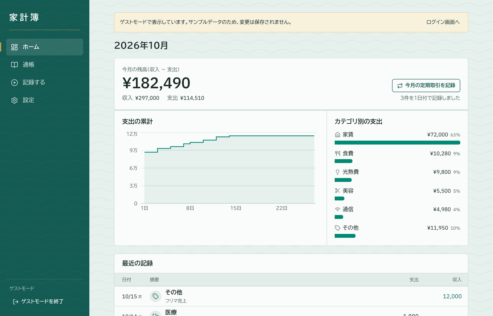
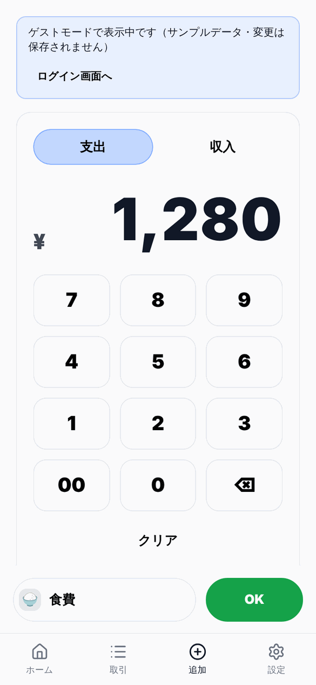
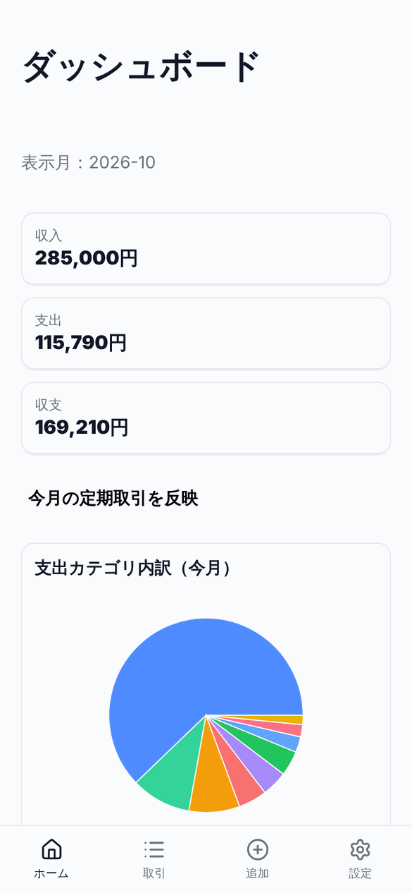
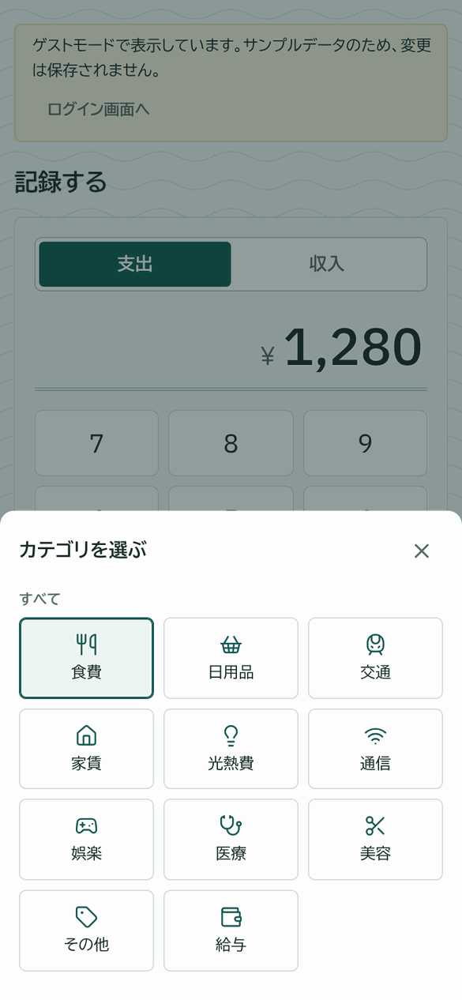
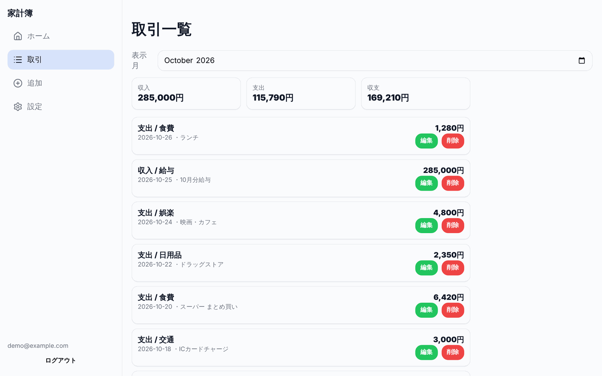
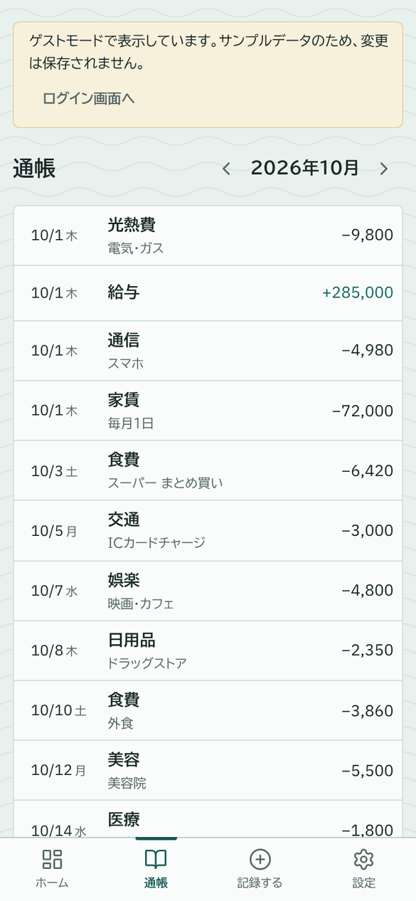
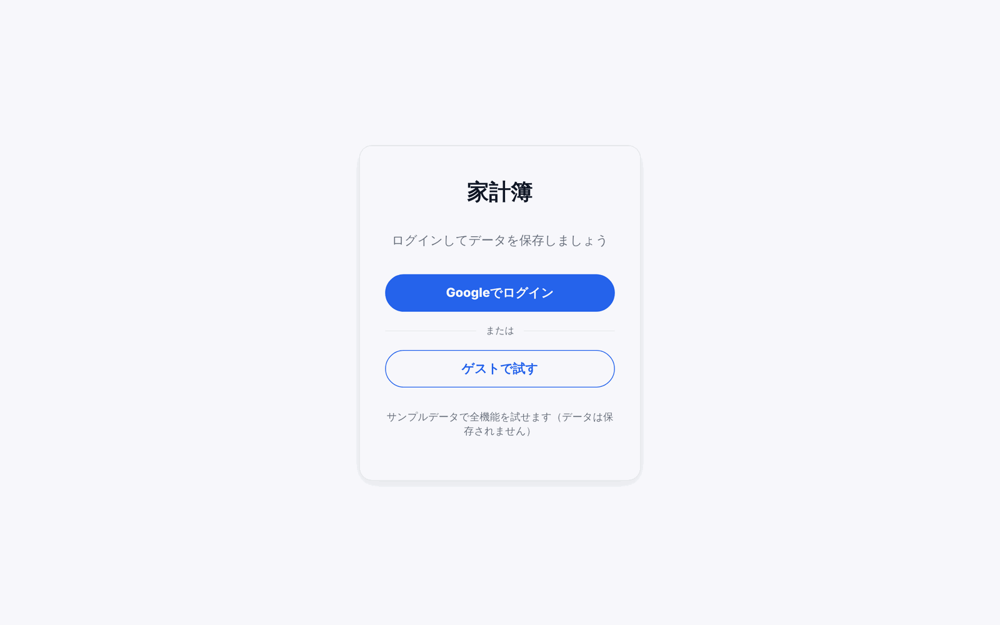

# 家計簿SPA

React + Supabase で作成した家計簿アプリです。
スマホファーストのUIで、Googleアカウントでログインしてデータをクラウド保存できます。

**デモ：** [kakeibo-spa.vercel.app](https://kakeibo-spa.vercel.app)

<p>
  
  
</p>

> スクリーンショットはサンプルデータで撮影しています。

---

## 画面

### ダッシュボード
今月の収入・支出・収支と、支出カテゴリの円グラフ／ランキングを表示します。

| PC | スマホ |
|---|---|
|  |  |

### 取引追加（電卓UI）
テンキーで金額を入力し、カテゴリはボトムシートから選びます。最近使ったカテゴリが上に出ます。

| 金額入力 | カテゴリ選択 |
|---|---|
|  |  |

### 取引一覧
月ごとに絞り込み、その場で編集・削除できます。

| PC | スマホ |
|---|---|
|  |  |

### ログイン


---

## 使用技術

| カテゴリ | 技術 |
|---|---|
| フロントエンド | React 19, React Router v7, Vite 7 |
| スタイル | プレーンCSS（CSS変数によるテーマ管理・メディアクエリ） |
| グラフ | Recharts |
| アイコン | lucide-react |
| バックエンド / DB | Supabase（PostgreSQL + Auth + REST API） |
| 認証 | Google OAuth 2.0（Supabase Auth経由） |
| デプロイ | Vercel |

---

## 主な機能

### ① 取引追加（電卓UI）
- テンキー入力で金額を入力（`00` キー・1文字削除・クリアあり）
- 支出 / 収入の切り替え
- 日付・メモの入力
- カテゴリ選択はボトムシート形式。最近使ったカテゴリを上部に表示（localStorageに保存）

### ② ダッシュボード
- 今月の収入・支出・収支サマリー
- 支出カテゴリの円グラフ
- 支出カテゴリのランキング（上位8件）
- 定期取引を今月分としてまとめて反映するボタン

### ③ 取引管理
- 月フィルターで絞り込み（月ごとの収支サマリー付き）
- インライン編集（カテゴリは一覧から選択 or 新規入力）
- 削除（確認モーダルあり）

### ④ カテゴリ管理
- カテゴリの追加・削除
- 初回ログイン時にデフォルトカテゴリ（食費・日用品・交通 など10件）を自動登録

### ⑤ 定期取引
- 家賃・通信費などの固定費／給与をテンプレとして登録
- ダッシュボードのボタンで当月1日付の取引として一括反映
- 反映済みのテンプレは記録しておき、同じ月に二重登録されない（フロント側の判定＋DBのユニーク制約）

---

## 設計のポイント

### 機能単位のディレクトリ構成
```
src/
├── app/            # ルーティング・共通レイアウト
├── features/
│   ├── auth/         # 認証（AuthContext, LoginPage）
│   ├── dashboard/    # ダッシュボード
│   ├── transactions/ # 取引の追加・一覧・TransactionsContext
│   └── settings/     # カテゴリ・定期取引（useCategories, useRecurring）
├── shared/hooks/   # 汎用Hook（useLocalStorage）
└── lib/            # Supabaseクライアント
```

### Context / カスタムHookによる関心の分離
データ取得・更新ロジックを `TransactionsContext`（取引）と `useCategories` / `useRecurring`（設定系）に切り出し、UIコンポーネントはデータ操作の詳細を知らなくて済む設計にしています。
取引データは複数画面（ダッシュボード・一覧・追加）で共有するため Context にまとめ、追加した取引がすぐ他の画面にも反映されるようにしています。

```js
// コンポーネント側はAPIだけ使う
const { transactions, addTransaction, deleteTransaction } = useTransactions();
```

### Supabase × Row Level Security（RLS）
SupabaseのRLSポリシーにより、ログインユーザーは自分のデータにしかアクセスできません。フロントエンドから直接DBを叩く構成でも、他ユーザーのデータが漏れない設計です。

```sql
-- 自分のデータのみ操作を許可するRLSポリシー
create policy "own data only"
  on transactions for all
  using (auth.uid() = user_id);
```

### React Context による認証状態の一元管理
`AuthContext` でログイン状態をグローバルに管理し、`RequireAuth` コンポーネントで未ログイン時はログイン画面を表示するルートガードを実装しています。

### スマホファーストUI
- PC：左サイドバーナビ
- スマホ（768px以下）：画面下部のボトムナビゲーション

CSS変数とメディアクエリで両対応しています。

### localStorage が使えない環境への配慮
`useLocalStorage` Hook は読み書きを try/catch で包み、Safariのプライベートモードなどで localStorage が使えなくてもアプリが落ちないようにしています。

---

## ローカルでの動作確認

```bash
git clone https://github.com/yusuketoyoda0716-hash/kakeibo-spa.git
cd kakeibo-spa
npm install
cp .env.example .env   # .env に実際のキーを記入
npm run dev
```

### 環境変数

`.env.example` を参考に `.env` ファイルを作成してください。

```
VITE_SUPABASE_URL=your_supabase_project_url
VITE_SUPABASE_ANON_KEY=your_supabase_anon_key
```

### Supabase のセットアップ

1. Supabaseプロジェクトを新規作成
2. Authentication → Providers で Google を有効化（Google Cloud で OAuth クライアントを作成）
3. Authentication → URL Configuration に `http://localhost:5173` とデプロイ先URLを追加
4. SQL Editor で以下を実行してテーブルを作成

```sql
create table transactions (
  id text primary key,            -- アプリ側で crypto.randomUUID() を生成して保存
  user_id uuid references auth.users not null,
  date text not null,             -- 例：2026-10-27
  type text not null check (type in ('expense', 'income')),
  category text not null,
  amount integer not null,        -- 円（整数）
  note text,
  recurring_id text,              -- 定期取引から反映した場合のテンプレID
  applied_month text,             -- 反映した月（例：2026-10）
  created_at timestamptz default now(),
  -- 同じテンプレを同じ月に二重反映しないための制約
  unique (user_id, recurring_id, applied_month)
);

create table categories (
  id bigint generated always as identity primary key,
  user_id uuid references auth.users not null,
  name text not null
);

create table recurring (
  id uuid primary key default gen_random_uuid(),
  user_id uuid references auth.users not null,
  type text not null check (type in ('expense', 'income')),
  category text not null,
  amount numeric not null,
  note text
);

-- RLS有効化
alter table transactions enable row level security;
alter table categories enable row level security;
alter table recurring enable row level security;

-- ポリシー設定
create policy "own data only" on transactions for all using (auth.uid() = user_id);
create policy "own data only" on categories for all using (auth.uid() = user_id);
create policy "own data only" on recurring for all using (auth.uid() = user_id);
```

---

## 今後の改善候補

- ダッシュボードの表示月切り替え・月次推移グラフ
- CSVエクスポート
- PWA化（オフライン対応）
- カテゴリアイコン設定
